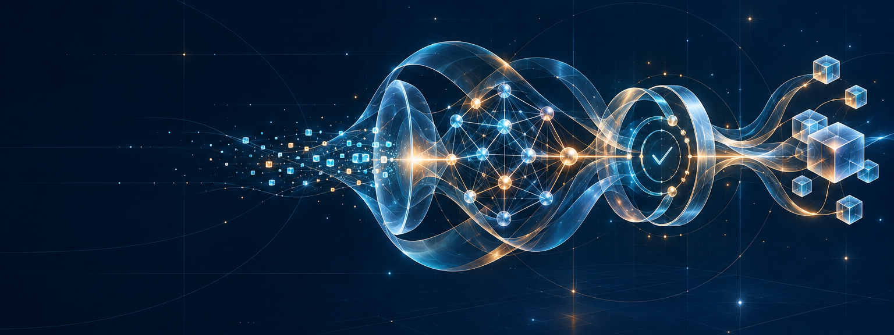

  

# Patrick | Applied AI Lab

**AI Engineering Learner**

### Build with curiosity. Evaluate with care. Share what holds up.

I'm learning AI engineering through hands-on experiments with local models, AI-assisted development, and cloud workflows. My goal is to understand model capabilities and build useful, measurable, and maintainable systems around them.

[Explore the portfolio](https://black-mushroom-0d1c5d30f.6.azurestaticapps.net) &nbsp;&middot;&nbsp; [Visit the Dell Local AI Lab](https://github.com/patrickh50/2017_Dell_7720_LocalAI_Lab)

---

## Learning at the intersection

| Local intelligence | Engineering discipline | Cloud integration |
| :--- | :--- | :--- |
| Exploring what local models can do within real hardware constraints. | Learning to evaluate quality, latency, resource use, and failure modes. | Learning Azure hosting, identity, deployment, and cost-aware design. |

## Explore the work

### Dell 7720 Local AI Lab

**Local inference &middot; Hardware constraints &middot; Hands-on learning**

A public project dedicated to running local AI models on a 2017 Dell Precision 7720 workstation. A practical setting for exploring the tradeoffs between model capability and available hardware.

**Modern AI on a nine-year-old workstation:** the 2017 Dell is the hardware-reuse side of the lab in 2026. The 2024 Alienware adds a newer platform for GPU acceleration and connected-laptop workflows. Together, they represent two complementary approaches to getting more from existing hardware.

[Open the public repository &rarr;](https://github.com/patrickh50/2017_Dell_7720_LocalAI_Lab)

### Alienware m16 R2 | Connected Local AI Lab

**2024 hardware &middot; RTX acceleration &middot; Multi-laptop experiments**

My newer local AI machine is a 2024 Alienware m16 R2. The focus is making useful AI run on hardware I already own: understanding memory limits, connecting laptops, and learning where custom applications add value.

  

| This machine | Verified configuration |
| :--- | :--- |
| **CPU** | Intel Core Ultra 9 185H &middot; 16 cores / 22 threads |
| **System memory** | 32 GB DDR5-5600 &middot; 2 &times; 16 GB modules |
| **Discrete GPU** | NVIDIA GeForce RTX 4070 **Laptop GPU** &middot; 8 GB GDDR6 VRAM |
| **Additional processors** | Intel Arc integrated graphics and Intel AI Boost NPU |
| **Wired experiment interface** | Thunderbolt 4 / USB4 via USB-C &middot; rated interface bandwidth up to 40 Gbps |

Installed CPU, RAM, GPU, and USB4/NPU devices checked locally on November 14, 2026. Rated interface capabilities: [Dell specifications and owner's manual](https://www.dell.com/support/product-details/en-us/product/alienware-m16-r2-laptop/resources/manuals).

<strong>Inside the experiments</strong>

- **NVIDIA PAIR (Personal AI Router):** connecting a peer laptop to an inference engine on the Alienware. Recorded lab tests established cross-laptop request routing, with PAIR selecting an execution node for each request.
- **Thunderbolt 4 / USB4 networking:** using a direct USB-C cable link for laptop-to-laptop IP communication, model requests, and file transfers. Lab runs measured roughly **26 Gbps network throughput with iperf3 in October 2026**.
- **Modern local models:** experimenting with quantized **gpt-oss-20b** and **Qwen3-30B-A3B** models using llama.cpp, with LM Studio and Ollama also explored. **GPU offload plus system RAM** supports experimentation with larger model configurations.
- **CUDA and custom applications:** exploring GPU-accelerated application development and practical integrations for local inference.
- **Engineering the whole workflow:** studying streaming responses, request handling, memory use, and thermal settings alongside generation throughput.

The lab combines completed routing and networking experiments with ongoing model and application exploration. Each experiment builds a clearer picture of how the hardware, runtime, and workflow work together.

### Applied AI Lab Portfolio

**Azure &middot; Web development &middot; Learning in public**

A developing home for project stories, experiments, and technical notes. The initial portfolio shell is live; detailed write-ups and results will follow as they are ready to share.

[Visit the website &rarr;](https://black-mushroom-0d1c5d30f.6.azurestaticapps.net)

## What I'm working toward

- **Reproducible experiments:** clear inputs, recorded settings, and repeatable comparisons.
- **Useful evaluation:** checking model answers against evidence and task-specific criteria.
- **Retrieval and grounding:** learning how to connect model responses to relevant source material.
- **Responsible integration:** protecting private data and keeping compute and API costs bounded.

<strong>My learning approach: build, measure, understand, document</strong>

1. **Start with a question.** Define the task and what a useful result would look like.
2. **Build the smallest experiment.** Keep the moving parts understandable.
3. **Measure and inspect.** Look at quality, performance, cost, and the cases that fail.
4. **Document the tradeoffs.** Separate observations from assumptions and revise when the evidence changes.

AI assistants can help develop ideas and code; testing and reviewing their output remain part of the work.

---

Personal projects. Ongoing learning. Original AI-generated conceptual banner and custom animated workflow illustration.
